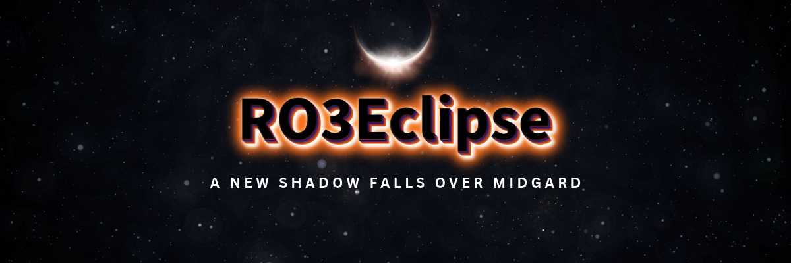

  

# RO3Eclipse

A private, personal Ragnarok Online 3 server.

## Development

- [Running from source](docs/development.md#running-from-source): the .NET 10 SDK and `scripts\start.cmd`
- [Repository layout and architecture](docs/development.md#repository-layout)
- [Tests and load tests](docs/development.md#tests)
- [System notes](docs/systems) and [client research](docs/research)
- [Fix list](FIXES.md)

---

Based on RO3Emu, free software under the [GNU General Public License v3.0](LICENSE). It is an independent research and
interoperability project, not affiliated with or endorsed by Gravity or any publisher of Ragnarok Online. It does not
include or distribute the game client, its data or its art; you need your own copy, and you are responsible for using it
in line with the applicable laws and license terms. Ragnarok Online is a trademark of Gravity Co., Ltd.
